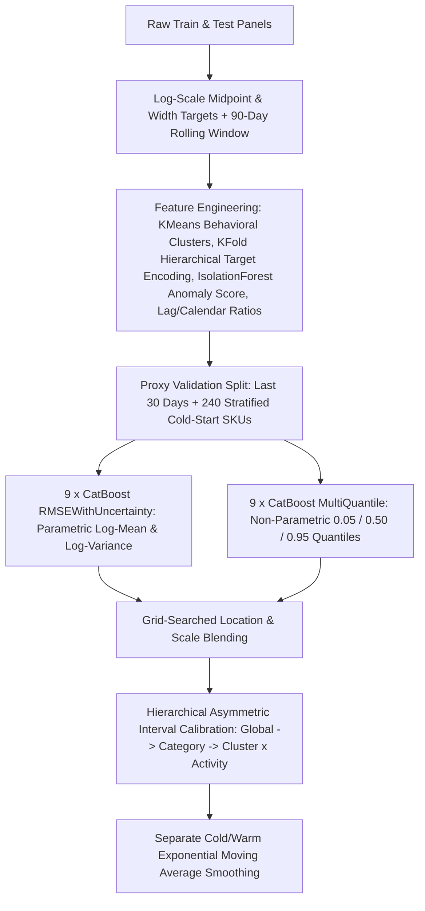

# Dynamic Retail Price-Interval Forecasting (`CatBoost` Uncertainty & Quantile Ensemble)

End-to-end competitive ML pipeline predicting daily lower and upper retail price bounds (`[price_p05, price_p95]`) per SKU, evaluated by **Mean 1D Intersection over Union (`IoU`)**.

- **Private Leaderboard (60% test split)**: **2nd Place** (`Mean 1D IoU = 0.265574`)
- **Public Leaderboard (40% test split)**: **3rd Place** (`Mean 1D IoU = 0.272687`)

---

## 1. Problem Formulation & Evaluation Metric

Given historical daily transaction records and hierarchical product metadata, predict `[price_p05, price_p95]` for every `(product_id, date)` pair in the test horizon, including cold-start SKUs unseen during the recent training window.

Predictions are scored by mean 1D interval `IoU`:

```text
intersection = max(0, min(y_high, pred_high) - max(y_low, pred_low))
union        = max(y_high, pred_high) - min(y_low, pred_low)
IoU          = intersection / union
```

Because `IoU` penalizes both under-coverage (narrow intervals missing true bounds) and over-coverage (excessively wide intervals inflating `union`), naive symmetric quantile regression degrades sharply under distribution shift and SKU cold start.

---

## 2. Modeling & Calibration Pipeline (`main.py`)



### Key Technical Components

1. **18-Model Heterogeneous `CatBoost` Ensemble (`9 x RMSEWithUncertainty` + `9 x MultiQuantile`)**:
   - `RMSEWithUncertainty` (`3,200` trees, `lr = 0.012`, `depth = 7`, `L2 = 15.0`) estimates parametric log-location `mu_unc` and log-variance `sigma_unc^2`.
   - `MultiQuantile(alpha=0.05,0.50,0.95)` (`3,800` trees, `lr = 0.015`, `depth = 6`, `L2 = 5.0`) captures non-parametric skewness directly.
   - Ensemble diversity across the 9 members per family is induced via depth offsets (`[-2..+2]`), feature subsampling (`rsm` in `[0.75..1.00]`), and bootstrap temperature schedules.
2. **Cold-Start Proxy Validation**:
   - Holds out the final `30` days as a temporal validation window and masks `240` historical SKUs (stratified to match the test `management_group_id` distribution) as synthetic cold-start items so blending weights and interval multipliers reflect unseen-SKU test behavior.
3. **Parametric + Non-Parametric Blending & Hierarchical Asymmetric Calibration**:
   - Blends location `mu_blend = w_mu * mu_unc + (1 - w_mu) * q_p50` and scale `sigma_blend = w_sigma * sigma_unc + (1 - w_sigma) * ((q_p95 - q_p05) / 3.29)`.
   - Fits asymmetric multipliers `(gamma_low, gamma_high)` maximizing `Mean 1D IoU` across a shrinkage hierarchy (`global cold/warm -> management_group_id -> cluster_id -> cluster x activity`), outputting `p05 = expm1(mu_blend - gamma_low * sigma_blend)` and `p95 = expm1(mu_blend + gamma_high * sigma_blend)`.
4. **Temporal Post-Processing**:
   - Exploits strong lag-1 autocorrelation (`0.67` on `price_p05`, `0.81` on interval width) via separately tuned Exponential Weighted Moving (`EWM`) smoothing parameters for warm vs. cold-start SKUs, followed by full-data refitting (`+15%` iterations over optimal validation early stopping).

---

## 3. Repository Structure

```text
AMML-pricing-competition/
|-- main.py                     # End-to-end feature, validation, ensemble, calibration & inference pipeline
|-- notebooks/
|   |-- EDA.ipynb               # Exploratory autocorrelation, cold-start & seasonality analysis
|   '-- EDA.md                  # Summary of empirical EDA findings
|-- data/                       # Competition train/test CSV panels
|-- results/                    # Generated submission outputs
|-- Dockerfile                  # Reproducible containerized execution
'-- requirements.txt            # Pinned Python dependencies
```

---

## 4. Reproducible Execution

### Local Virtual Environment

```bash
git clone https://github.com/maxlyara1/AMML-pricing-competition.git
cd AMML-pricing-competition

python3 -m venv .venv
source .venv/bin/activate
pip install -r requirements.txt

python main.py
```

### Docker

```bash
docker build -t pricing-interval-solution .
docker run --rm \
  -v "$(pwd)/data:/app/data" \
  -v "$(pwd)/results:/app/results" \
  pricing-interval-solution
```
